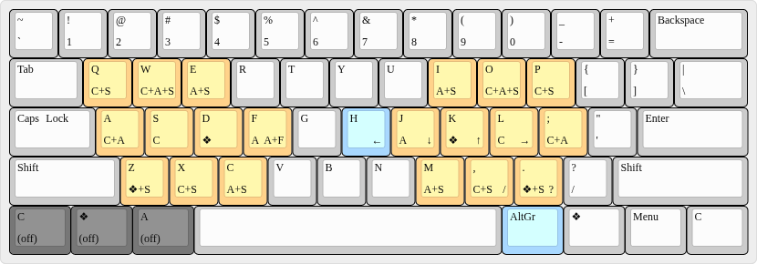

# kanata

My [kanata](https://github.com/jtroo/kanata) config: home-row mods, with AltGr arrows and symbols.

To edit the layout, upload [keyboard-layout-editor.com.json](keyboard-layout-editor.com.json) to [keyboard-layout-editor.com](http://www.keyboard-layout-editor.com).

## Install

1. Place the `kanata` binary next to `install-kanata.sh`.
2. Run `./install-kanata.sh`.
